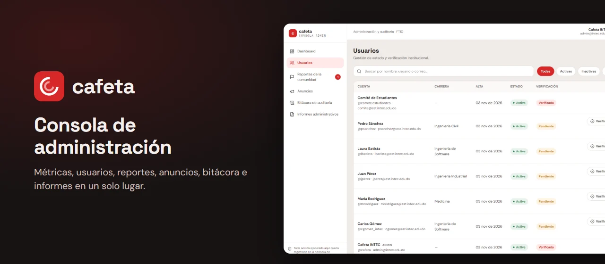

<div align="center">
  <br />
  
  <br />

  <div>


  </div>

  <h3 align="center">Cafeta · Consola de administración</h3>

  <p align="center"><a href="https://cafeta-admin-hj01.azurewebsites.net">cafeta-admin-hj01.azurewebsites.net</a></p>

  <p align="center">La consola web con la que se supervisa y modera Cafeta, la red social de la comunidad universitaria de INTEC.</p>
</div>

## 📋 <a name="table">Tabla de contenido</a>

1. ✨ [Introducción](#introduction)
2. 📸 [Pantallas](#screens)
3. ⚙️ [Stack](#tech-stack)
4. 🔋 [Funciones](#features)
5. 🗂️ [Estructura](#project-structure)
6. 🤸 [Inicio rápido](#quick-start)
7. 🧪 [Pruebas](#tests)
8. 🚀 [Despliegue](#deployment)
9. 🧩 [Los otros repos](#related)
10. 📬 [Contacto](#contact)

## <a name="introduction">✨ Introducción</a>

La app de Cafeta es de teléfono y para estudiantes. Moderar una comunidad es otro trabajo: de pantalla ancha, con tablas y con permisos distintos. Por eso la administración vive en su propia aplicación.

Solo entra quien tiene rol `ADMIN`, y esas cuentas no se registran por la web: nacen en la semilla o con un comando de la API. Cada pantalla lee y escribe en [cafeta-api](https://github.com/hjmnz-dev/cafeta-api), y las acciones de la consola quedan en la bitácora de auditoría.

Nació como proyecto académico en INTEC y está desplegada en producción.

## <a name="screens">📸 Pantallas</a>

Capturas con los datos ficticios de la semilla de demo.

<div align="center">
  
  
  
  
</div>

## <a name="tech-stack">⚙️ Stack</a>

- **[React 18](https://react.dev)** y **[TypeScript](https://www.typescriptlang.org)** en modo strict.
- **[Vite 6](https://vite.dev)** para el servidor de desarrollo y el build.
- **[Tailwind CSS 4](https://tailwindcss.com)** y **[Lucide](https://lucide.dev)** para la interfaz.
- **[React Router 7](https://reactrouter.com)** para las rutas.
- **[TanStack Query 5](https://tanstack.com/query)** para los datos, con tipos generados desde el OpenAPI de la API.
- **[Sentry](https://sentry.io)** para el monitoreo de errores.
- **[Vitest](https://vitest.dev)** y **[Testing Library](https://testing-library.com)** para las pruebas; **oxlint** y **Prettier** para lint y formato.

## <a name="features">🔋 Funciones</a>

👉 **Dashboard**: Reportes pendientes, cuentas por verificar, usuarios activos, publicaciones e historias vigentes de un vistazo.

👉 **Usuarios**: Búsqueda por nombre, usuario o correo, filtros por estado y verificación institucional.

👉 **Desactivar y reactivar cuentas**: Con confirmación y una nota obligatoria. La baja es lógica: la cuenta conserva su registro.

👉 **Reportes de la comunidad**: Revisa lo que denuncian los estudiantes y desestímalo, desactiva la publicación o desactiva la cuenta.

👉 **Anuncios institucionales**: Redacta y publica avisos para la comunidad.

👉 **Bitácora de auditoría**: Consulta quién hizo qué y cuándo, con filtros y solo de lectura.

👉 **Informes**: Actividad y moderación por rango de fechas, con descarga en CSV.

👉 **Acceso controlado**: Todas las secciones pasan por `RequireAdmin`, y la API vuelve a exigir el rol en cada ruta.

👉 **Errores claros**: Un solo cliente HTTP traduce cada `code` de la API a un mensaje en español.

## <a name="project-structure">🗂️ Estructura</a>

```text
deploy/
└── server.mjs        Servidor estático de producción en App Service
docs/readme/          Imágenes de este README
public/               Iconos
src/
├── admin/
│   ├── components/   Una pantalla por archivo y sus piezas
│   ├── lib/          Lógica pura, cliente HTTP y tipos generados desde OpenAPI
│   ├── store/        Sesión y hooks de TanStack Query por pantalla
│   └── routes.tsx    Rutas, todas bajo RequireAdmin
├── styles/           Tokens de marca y base de Tailwind
└── test/             Configuración de las pruebas
```

## <a name="quick-start">🤸 Inicio rápido</a>

Sigue estos pasos para correr la consola en tu máquina.

**Requisitos**

- [Git](https://git-scm.com/)
- [Node.js](https://nodejs.org/en) 24, con npm
- [cafeta-api](https://github.com/hjmnz-dev/cafeta-api) corriendo en el puerto 3000; su README explica cómo levantarla con datos de demo

**Clonar el repositorio**

```bash
git clone https://github.com/hjmnz-dev/cafeta-admin-web.git
cd cafeta-admin-web
```

**Instalación**

```bash
npm install
```

**Correr el proyecto**

Usa el puerto 5174, que es el `ADMIN_ORIGIN` de la API:

```bash
npm run dev -- --port 5174
```

Abre [http://localhost:5174](http://localhost:5174) en tu navegador y entra con el `SEED_ADMIN_EMAIL` y el `SEED_ADMIN_PASSWORD` de tu `.env` de la API.

**Variables de entorno**

No necesitas ninguna en local: sin `VITE_API_URL`, la consola usa `http://localhost:3000/api/v1`, y sin `VITE_SENTRY_DSN` no envía nada a Sentry. Están explicadas en [`.env.example`](.env.example).

## <a name="tests">🧪 Pruebas</a>

```bash
npm test              # pruebas con Vitest y Testing Library
npm run lint          # revisa todo el repo y falla con cualquier aviso
npm run format:check  # revisa el formato
npm run typecheck     # revisa los tipos
npm run api:types     # regenera los tipos desde OpenAPI, con la API en el puerto 3000
```

Husky y lint-staged revisan lint, formato y tipos antes de cada commit, y el CI repite todo en cada push y en cada PR.

## <a name="deployment">🚀 Despliegue</a>

La consola corre en [cafeta-admin-hj01.azurewebsites.net](https://cafeta-admin-hj01.azurewebsites.net), en [Azure App Service](https://azure.microsoft.com/products/app-service) (Canada Central). Cada push a `main` corre el CI y, solo si todo pasa, el job `deploy`:

1. Compila con la URL de la API y el DSN de Sentry del ambiente `production`.
2. Sube los source maps a Sentry y comprueba que ninguno quede publicado.
3. Entra a Azure con OIDC, sin contraseñas guardadas en GitHub, y sube `dist/` con `deploy/server.mjs`.
4. Espera a que `/version.txt` muestre el commit nuevo.

Las demás ramas y los PR nunca despliegan.

## <a name="related">🧩 Los otros repos</a>

Cafeta son tres repositorios que se despliegan por separado:

- **[cafeta-api](https://github.com/hjmnz-dev/cafeta-api)**: la API.
- **[cafeta-app](https://github.com/hjmnz-dev/cafeta-app)**: la app web del estudiante.
- **[cafeta-admin-web](https://github.com/hjmnz-dev/cafeta-admin-web)**: esta consola.

## <a name="contact">📬 Contacto</a>

**Hamsell Jiménez**

- [GitHub](https://github.com/hjmnz-dev)
- [LinkedIn](https://www.linkedin.com/in/hamselljimenez)
- [hamselljimenez@gmail.com](mailto:hamselljimenez@gmail.com)
