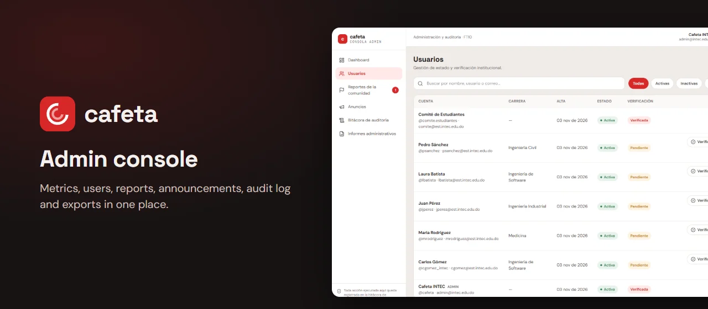
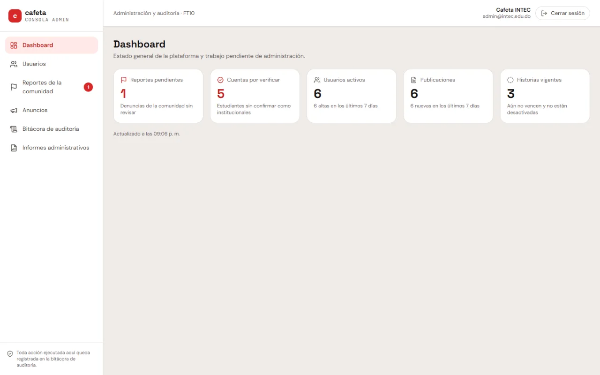
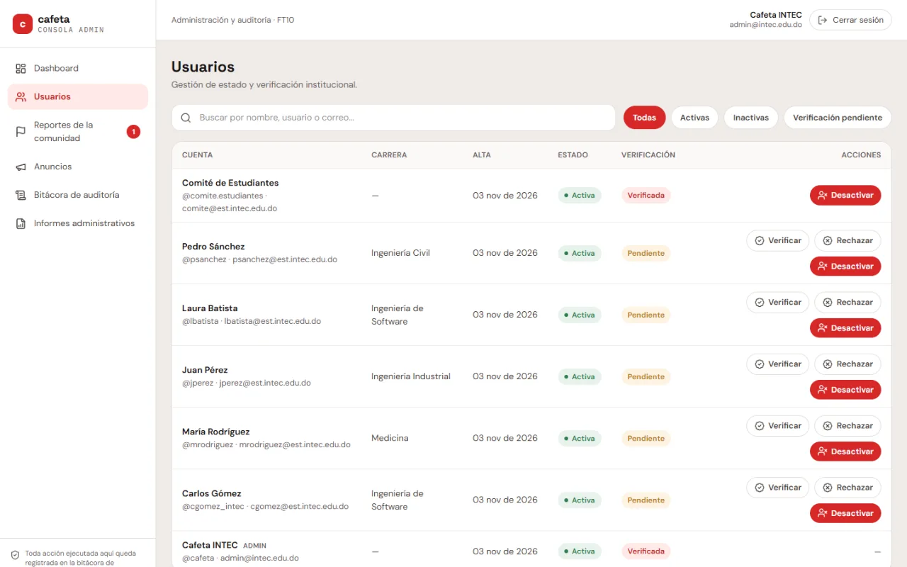
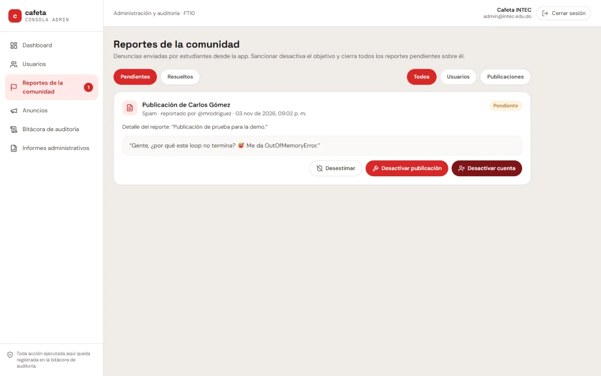
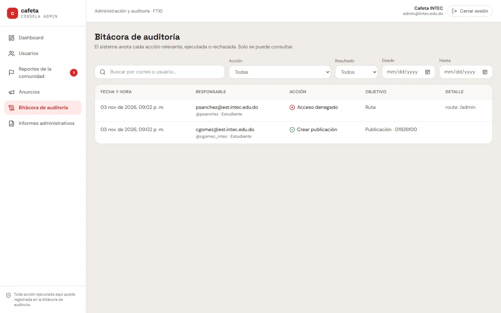

<div align="center">
  <br />
  
  <br />

  <div>


  </div>

  <h3 align="center">Cafeta · Admin Console</h3>

  <p align="center"><a href="https://cafeta-admin-hj01.azurewebsites.net">cafeta-admin-hj01.azurewebsites.net</a></p>

  <p align="center">The web console used to oversee and moderate Cafeta, the social network for the INTEC university community.</p>

  <p align="center"><b>English</b> · <a href="README.es.md">Español</a></p>
</div>

## 📋 <a name="table">Table of Contents</a>

1. ✨ [Introduction](#introduction)
2. 📸 [Screens](#screens)
3. ⚙️ [Tech Stack](#tech-stack)
4. 🔋 [Features](#features)
5. 🗂️ [Project Structure](#project-structure)
6. 🤸 [Quick Start](#quick-start)
7. 🧪 [Tests](#tests)
8. 🚀 [Deployment](#deployment)
9. 🧩 [Related Repos](#related)
10. 📬 [Contact](#contact)

## <a name="introduction">✨ Introduction</a>

The Cafeta app is built for phones and for students. Moderating a community is a different job: wide screens, tables and different permissions. That is why administration lives in its own application.

Only users with the `ADMIN` role can sign in, and those accounts can't be created from the web: they come from the seed or from an API command. Every screen reads from and writes to [cafeta-api](https://github.com/hjmnz-dev/cafeta-api), and console actions are recorded in the audit log.

It started as an academic project at INTEC and runs in production. The interface is in Spanish, the language of its users.

## <a name="screens">📸 Screens</a>

Screenshots with the fictional data from the demo seed.

<div align="center">
  
  
  
  
</div>

## <a name="tech-stack">⚙️ Tech Stack</a>

- **[React 18](https://react.dev)** and **[TypeScript](https://www.typescriptlang.org)** in strict mode.
- **[Vite 6](https://vite.dev)** for the development server and production build.
- **[Tailwind CSS 4](https://tailwindcss.com)** and **[Lucide](https://lucide.dev)** for the interface.
- **[React Router 7](https://reactrouter.com)** for routing.
- **[TanStack Query 5](https://tanstack.com/query)** for data, with types generated from the API's OpenAPI contract.
- **[Sentry](https://sentry.io)** for error monitoring.
- **[Vitest](https://vitest.dev)** and **[Testing Library](https://testing-library.com)** for tests; **oxlint** and **Prettier** for linting and formatting.

## <a name="features">🔋 Features</a>

👉 **Dashboard**: Pending reports, accounts awaiting verification, active users, posts and live stories at a glance.

👉 **Users**: Search by name, username or email, with filters by status and institutional verification.

👉 **Deactivate and Reactivate Accounts**: With confirmation and a required note. Deactivation is soft: the account keeps its record.

👉 **Community Reports**: Review what students report and dismiss it, deactivate the post or deactivate the account.

👉 **Institutional Announcements**: Write and publish announcements for the community.

👉 **Audit Log**: Read-only view of who did what and when, with filters.

👉 **Reports**: Activity and moderation by date range, with CSV download.

👉 **Access Control**: Every section goes through `RequireAdmin`, and the API checks the role again on every route.

👉 **Clear Errors**: A single HTTP client translates each API `code` into a message in Spanish.

## <a name="project-structure">🗂️ Project Structure</a>

```text
deploy/
└── server.mjs        Production static server on App Service
docs/readme/          Images for this README
public/               Icons
src/
├── admin/
│   ├── components/   One screen per file, plus its pieces
│   ├── lib/          Pure logic, HTTP client and types generated from OpenAPI
│   ├── store/        Session and TanStack Query hooks per screen
│   └── routes.tsx    Routes, all behind RequireAdmin
├── styles/           Brand tokens and Tailwind base
└── test/             Test setup
```

## <a name="quick-start">🤸 Quick Start</a>

Follow these steps to run the console on your machine.

**Prerequisites**

- [Git](https://git-scm.com/)
- [Node.js](https://nodejs.org/en) 24, with npm
- [cafeta-api](https://github.com/hjmnz-dev/cafeta-api) running on port 3000; its README explains how to start it with demo data

**Cloning the Repository**

```bash
git clone https://github.com/hjmnz-dev/cafeta-admin-web.git
cd cafeta-admin-web
```

**Installation**

```bash
npm install
```

**Running the Project**

Use port 5174, which is the API's `ADMIN_ORIGIN`:

```bash
npm run dev -- --port 5174
```

Open [http://localhost:5174](http://localhost:5174) in your browser and sign in with the `SEED_ADMIN_EMAIL` and `SEED_ADMIN_PASSWORD` from the API's `.env`.

**Environment Variables**

None are needed locally: without `VITE_API_URL`, the console uses `http://localhost:3000/api/v1`, and without `VITE_SENTRY_DSN` it sends nothing to Sentry. They are explained in [`.env.example`](.env.example).

## <a name="tests">🧪 Tests</a>

```bash
npm test              # tests with Vitest and Testing Library
npm run lint          # checks the whole repo and fails on any warning
npm run format:check  # checks formatting
npm run typecheck     # checks types
npm run api:types     # regenerates the types from OpenAPI, with the API on port 3000
```

Husky and lint-staged check linting, formatting and types before every commit, and CI runs everything again on every push and pull request.

## <a name="deployment">🚀 Deployment</a>

The console runs at [cafeta-admin-hj01.azurewebsites.net](https://cafeta-admin-hj01.azurewebsites.net), on [Azure App Service](https://azure.microsoft.com/products/app-service) (Canada Central). Every push to `main` runs CI and, only if everything passes, the `deploy` job:

1. Builds with the API URL and Sentry DSN from the `production` environment.
2. Uploads the source maps to Sentry and checks that none get published.
3. Signs in to Azure with OIDC, with no passwords stored in GitHub, and uploads `dist/` with `deploy/server.mjs`.
4. Waits until `/version.txt` shows the new commit.

Other branches and pull requests never deploy.

## <a name="related">🧩 Related Repos</a>

Cafeta is made of three repositories that deploy separately:

- **[cafeta-api](https://github.com/hjmnz-dev/cafeta-api)**: the API.
- **[cafeta-app](https://github.com/hjmnz-dev/cafeta-app)**: the student web app.
- **[cafeta-admin-web](https://github.com/hjmnz-dev/cafeta-admin-web)**: this console.

## <a name="contact">📬 Contact</a>

**Hamsell Jiménez**

- [GitHub](https://github.com/hjmnz-dev)
- [LinkedIn](https://www.linkedin.com/in/hamselljimenez)
- [hamselljimenez@gmail.com](mailto:hamselljimenez@gmail.com)
